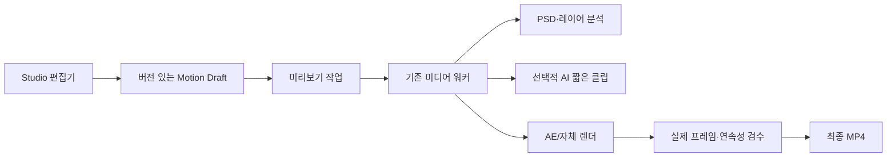

# Motion Studio 제품 기획

## 결정

Motion Studio는 웹툰 전용 편집기가 아니다. 이미지·PSD·기존 영상·짧은 AI 영상 클립을 조합해 유튜브용 영상을 만드는 웹 기반 모션 편집기다.

웹앱은 편집·미리보기·승인 화면을 맡고, 무거운 분석과 렌더링은 기존 워커에 통합한다. 브라우저에서 장시간 렌더링하거나 Adobe 데스크톱 앱을 사용자에게 요구하지 않는다.

| 구분 | 세로형 | 가로형 |
| --- | --- | --- |
| 대상 | Shorts, Reels, 세로 웹툰, 모바일 광고 | 일반 유튜브, 드라마형 스토리, 해설·리뷰 |
| 기준 비율 | 9:16, 1080×1920 | 16:9, 1920×1080 |
| 기본 연출 | 빠른 컷, 세로 패닝, 인물 클로즈업 | 와이드 구도, 장면 간 연속성, 복수 인물 배치 |
| 원본 처리 | 세로 원본 보존을 우선 | 가로 원본 보존을 우선, 세로 소스는 안전 영역 크롭 또는 배경 확장 |
| 자막 안전 영역 | 상·하단 UI를 피한 중앙 영역 | 하단 자막 및 좌·우 인물 보호 영역 |

프로젝트는 처음에 비율을 고정한다. 같은 프로젝트 안에서 세로·가로 프레임을 섞어 만들지 않으며, 필요하면 공통 소스에서 별도 출력 프로젝트를 만든다.

## 사용자 흐름

1. 사용자가 `세로 9:16` 또는 `가로 16:9` 프로젝트를 만든다.
2. 씬별로 PSD, 이미지, 기존 영상 또는 AI 영상 요청을 넣는다.
3. Codex가 대본·음성·소스 레이어를 보고 씬별 초안 연출을 제안한다.
4. 사용자는 캔버스와 타임라인에서 카메라, 레이어, 효과, 전환, AI 삽입 구간을 수정한다.
5. 짧은 저해상도 미리보기를 요청하고 확인한다.
6. 최종 음성·자막을 확정한 뒤 고화질 렌더를 제출한다.
7. 워커가 실제 출력과 인접 씬 연속성을 검수한 뒤 최종 MP4를 만든다.

## 편집 화면

### 1. 씬 레일

- 씬 순서, 길이, 현재 소스 상태, 렌더 상태를 표시한다.
- 각 씬을 `AE/레이어 연출`, `기존 영상 사용`, `짧은 AI 삽입`, `정지 이미지 컷`으로 지정한다.
- AI 삽입은 0.5~2초를 기본값으로 하며, 동일 캐릭터의 얼굴이 크게 보이는 장면에는 경고한다.

### 2. 캔버스

- 비율별 안전 영역, 자막 영역, 카메라 프레임을 표시한다.
- PSD의 배경·인물·소품·머리카락·전경 레이어를 선택한다.
- 위치, 크기, 회전, 불투명도, 깊이값을 조작한다.
- 세로 프로젝트에서는 원본의 세로 구도를 우선 보존하고, 가로 프로젝트에서는 카메라 프레임 안에서 안전하게 크롭한다.

### 3. 타임라인

- 장면, 레이어, 카메라, 효과, 자막, 음성, 효과음 트랙을 분리한다.
- 키프레임은 위치·크기·회전·불투명도·빛·효과 강도를 지원한다.
- 프리셋으로 전투 타격, 검기·오라, 충돌·파괴, 분위기·빛, 대화 클로즈업, 빠른 전환을 제공한다.
- 전환은 기본적으로 컷·페이드·플래시 컷으로 제한한다. 장면 연결이 확인된 경우에만 복잡한 전환을 제안한다.

### 4. Codex 감독 패널

- 각 씬에 대해 카메라 경로, 레이어 모션, 광원 방향, 전환 이유, 효과 시점을 제안한다.
- 제안은 항상 사용자가 편집 가능한 키프레임과 효과 설정으로 변환한다.
- 원화에 없는 인물 동작이나 숨은 배경이 필요하면 자동 승인을 하지 않고 `대체 포즈 필요`, `배경 보완 필요`, `짧은 AI 삽입 후보`로 분류한다.

## 소스와 연출 범위

| 소스 | 자동화 가능한 작업 | 준비 조건 |
| --- | --- | --- |
| PSD/PSB | 패럴랙스, 카메라, 레이어 모션, 머리·옷 제한 변형, 빛·파티클 | 배경과 움직일 요소가 분리된 레이어 |
| 이미지 | 카메라 이동, 크롭, 가벼운 오버레이 효과 | 충분한 해상도 |
| 기존 영상 | 컷 편집, 색보정, 자막, 효과, 전환 | 사용 권한과 씬 시간 정보 |
| AI 영상 API | 짧은 동작·배경 변화·실루엣 액션 | 명시적 제공자 설정, 비용 한도, 참조 이미지 |

AI 영상은 전체 영상의 기본 방식으로 사용하지 않는다. 캐릭터 변형 가능성이 낮은 짧은 연결 장면에만 사용하며, 결과가 원화의 인물·의상·구도와 다르면 재생성 또는 AE 전용 연출로 되돌린다.

## 워커 통합 구조

### 웹앱이 맡는 일

- 프로젝트·비율·타임라인 초안 저장
- 캔버스 편집과 저해상도 클라이언트 미리보기
- 에셋 업로드와 사용자 승인
- 렌더 요청, 진행 상태, 결과 비교 표시

### 워커가 맡는 일

- PSD 구조 분석과 레이어 패키지 생성
- Codex 감독 계획 생성 및 검수
- 저해상도 미리보기 렌더와 고화질 최종 렌더
- AE 렌더가 필요한 씬의 JSX/AEP 생성과 `aerender` 실행
- 짧은 AI 클립 요청·재시도·비용 기록·원화 일치 검수
- 인접 씬 경계, 음성 길이, 자막 안전 영역, 실제 출력 프레임 검수

기존 `ae_scene_preparation`, `ae_highlight_worker`, `premiere_final_worker`, `local_media_supervisor`를 재사용한다. 새 워커는 별도 데몬보다 이들 워커가 공통으로 소비할 `motion_render` 작업 유형과 렌더 단계로 추가한다. 이렇게 하면 현재의 재시도, 하트비트, GCS 보관, 최종 제출 검수 체계를 유지할 수 있다.

## 데이터 계약

- `motion_project/v1`: 비율, FPS, 출력 해상도, 안전 영역, 씬 순서.
- `motion_timeline/v1`: 레이어·키프레임·효과·전환·AI 삽입 요청. 웹 편집 중에는 수정 가능하다.
- `motion_render_manifest/v1`: 제출 시점의 타임라인, 소스 SHA-256, 음성 SHA-256, 템플릿 버전, AI 결과 ID를 고정한다.
- `motion_render_review/v1`: 실제 렌더 프레임의 자막 가독성, 소스 동일성, 장면 경계, 세로/가로 안전 영역, AI 클립 연속성 검수 결과를 저장한다.

초안은 `project_payload.render_settings.motion`에 둘 수 있지만, 제출 후에는 기존 렌더 큐처럼 별도 불변 매니페스트와 GCS 소스를 사용한다. 편집 중인 데이터를 렌더 중인 작업이 읽지 않게 한다.

## 구현 순서

### 1단계: 기존 AE 씬 기능을 편집 가능한 Motion Draft로 승격

- 비율 선택을 프로젝트 설정에 추가한다.
- PSD 씬의 카메라·레이어·효과 계획을 타임라인 데이터로 저장한다.
- 현재 전투·빛 프리셋을 타임라인 UI에서 선택·조절하게 한다.
- 세로·가로별 안전 영역과 렌더 해상도를 강제한다.

### 2단계: 미리보기와 일반 영상 편집

- 이미지·PSD·기존 영상 모두를 한 씬 캔버스에 올린다.
- 저해상도 프록시 렌더 작업을 워커에 추가한다.
- 편집기에서 프록시 MP4와 최종 렌더를 명확히 구분한다.

### 3단계: 선택적 AI 영상 삽입

- 제공자 API 어댑터를 워커에만 둔다.
- 장면별 길이·참조 이미지·프롬프트·비용 상한을 매니페스트에 고정한다.
- 생성 결과를 원화 기준 프레임과 비교하고, 캐릭터·의상·카메라 불일치를 자동 거절한다.

### 4단계: 전용 자체 렌더러 확대

- AE가 없어도 가능한 카메라·패럴랙스·오버레이·자막·전환은 자체 렌더러로 처리한다.
- 복잡한 PSD 변형과 고급 효과만 Adobe GPU 워커로 보낸다.
- 장기적으로는 Adobe 의존 구간을 줄이되, 검증된 AE 템플릿은 계속 사용한다.

## 성공 기준

- 세로·가로 프로젝트가 서로 다른 안전 영역과 출력 해상도를 유지한다.
- PSD 또는 기존 영상만으로도 AI 없이 완성 가능한 씬을 만든다.
- AI 삽입이 필요한 씬은 비용·길이·소스 참조를 추적 가능하다.
- 최종 음성이 바뀌면 미리보기는 갱신되지만, 제출된 렌더 매니페스트는 바뀌지 않는다.
- 실제 출력 검수 없이 자동 승인하거나, 검수 실패한 AI 클립을 최종 영상에 사용하지 않는다.
