> 과거 설계·문제 분석 기록입니다. 아래의 제출 전 AE 미리보기 생성, 모델 검수 제거 등은 현재 모든 실행 계열의 동작을 설명하지 않습니다. 현행 책임·상태·엔진 정책은 [워커 역할 계약](worker-workflow-boundary.md)을 따릅니다. 제출 전에는 연출·소재를 준비하고 실제 AE 실행은 제출 후 통합워커가 담당합니다. 대체 엔진은 현재 비활성입니다.

# 사용자 제출부터 최종 렌더까지 통합 워커 재설계

사용자가 웹에서 영상, 화자, 성우, BGM, 효과음, 썸네일을 확정해 제출하면 통합 워커가 선택된 에셋을 조립해 최종 파일을 자동으로 제공한다. 제출 이후 모델이 사용자 선택을 다시 판단하거나 설정을 바꾸지 않는다. 이미 생성된 파일은 재사용하고, 필수 파일과 시간표의 기술적인 문제만 처리한다.

이 문서는 구현 계약과 운영 순서를 함께 기록한다. 신규 제출 파이프라인 버전은 2이며, 과거 승인 기반 작업을 자동 변환하지 않는다. 현재 완성 영상의 41개 클립 짧은 삽입은 사용자가 별도로 승인한 편집이며, 일반 제출의 기본 동작으로 적용하지 않는다.

## 1 현재 흐름과 책임

| 구간 | 현재 코드 | 확인한 동작 |
| --- | --- | --- |
| 대본 및 이미지 준비 | `worker/generated_speaker_coordinates.py`, `worker/prepared_mouth_layers.py` | 이미지 공개 후 화자 좌표와 입 상태별 레이어를 준비하고 원본 해시를 기록한다. |
| 사용자 확정과 제출 | `auth-web/app/std/page.tsx`, `auth-web/app/api/std/projects/[projectId]/submit/route.ts` | 사용자가 설정을 저장하고 제출하면 AE 작업이 있으면 후작업 대기 상태로 들어간다. |
| 입모양 처리 | `worker/ae_mouth_worker.py` | 준비 레이어를 재사용해도 `review_layers`를 다시 호출한다. |
| 자동 연출 및 출력 검수 | `worker/ae_mouth_automation.py` | 연출, 프레임 묶음별 출력 평가, 렌더 등록으로 단계를 나눈다. 모델 검사 실패도 씬 실패로 기록한다. |
| 워커 운영 | `worker/local_media_supervisor.py`, `worker/ae_mouth_runtime.py` | 역할별 하위 프로세스를 실행한다. 역할 실패 누적과 전역 프로세스 감지가 다른 작업의 진행에도 영향을 준다. |
| 렌더 설정과 음향 | `auth-web/lib/stdRenderQueue.ts`, `stdAudioMix.ts`, `stdSfxCues.ts` | 저장된 음악 구간과 효과음 앵커를 실제 시간으로 계산한다. |
| 에셋 다운로드와 렌더 | `remote_drive_worker.py`, `services/ffmpeg_slideshow_service.py` | 매니페스트를 순서대로 다운로드하고 파일 해시를 확인한 뒤 FFmpeg 렌더와 업로드를 수행한다. |

대본 워커의 좌표 기반 이미지 준비, 사용자 웹의 선택, 통합 워커의 조립은 서로 다른 책임이다. 제출 후 통합 워커가 대본 작성자나 콘텐츠 검수자의 역할까지 다시 수행하는 것이 현재 지연의 주요 원인이다.

## 2 이번 작업에서 바로잡아야 할 원인

| 발생한 문제 | 원인 | 재설계에서의 처리 |
| --- | --- | --- |
| 준비된 입 레이어를 다시 검사 | 준비 단계와 제출 후 단계가 같은 판단을 반복 | 준비된 레이어의 원본 해시와 파일 계약만 확인하고 바로 조립 |
| 정상 파일도 검수 실패로 처리 | 프레임 범위, 좌표 증거 전달, 시점 비교 오류 및 모델 시간 초과 | 제출 후 모델 연출 검수와 출력 미관 검수 제거 |
| 실패를 원본 대체로 기록했지만 렌더는 정지 | 씬 실패 처리와 `auto_enqueue`의 차단 규칙 충돌 | 선택된 실패 정책을 한곳에서 적용하고, 원본 대체 완료도 렌더 준비 완료로 집계 |
| 오래된 좌표가 다시 선택 | 여러 좌표 영수증 중 우선순위와 유효성에 따라 최신 수정이 탈락 | 제출 매니페스트에 사용할 좌표 영수증 ID와 버전을 하나로 고정 |
| 입력에 상태 필드가 추가돼 기존 작업 무효화 | 제작 입력과 처리 상태가 같은 지문에 포함 | 제작에 영향을 주는 입력만 정규화해 해시 계산, 상태는 별도 저장 |
| 한 작업의 재시도가 다른 작업까지 막음 | 역할 전체의 실패 횟수와 전역 자원 감지 | 재시도 횟수는 작업·단계·에셋별로 관리, 자원 잠금은 소유 작업별로 관리 |
| 워커가 종료되고 수동 복구가 반복 | 실행 상태와 임대 소유권, 실제 진행 상태가 충분히 구분되지 않음 | 임대 만료 복구, 단계별 체크포인트, 진행량 기반 타임아웃 |
| 완성 파일을 여러 번 다시 다운로드 | 원본 해시 기반 공용 캐시와 다운로드 체크포인트 부족 | 공용 파일 캐시, 중단점 다운로드, 제한된 병렬 다운로드 |
| 전체 영상의 BGM이 잘못 변경 | 제가 사용자 웹 저장값을 임의로 덮어씀 | 렌더 워커는 사용자 설정을 읽기만 하고 변경 권한을 갖지 않음 |
| 효과음을 다른 파일과 볼륨으로 대체 | 제가 선택된 설정 대신 별도 해석으로 복구 | 선택된 `asset_id`, 볼륨, 길이, 앵커를 제출 시 그대로 고정 |
| 음원 누락 원인을 성급히 단정 | 실제로 이미 적용된 음원 역할 정규화를 다시 문제로 지목 | 웹 저장값과 생성된 렌더 설정의 차이를 먼저 비교하고 원인을 확정 |
| 확장 대본의 미녹음 자막이 다시 섞임 | 편집 초안과 확정 녹음의 자막이 같은 변경 가능한 payload에 공존 | 편집 초안과 확정 녹음 세트를 분리하고 제출은 확정 녹음 ID에 연결 |

생성 완료, 기술적으로 사용 가능한 파일, 사용자 선택, 모델 판단 결과를 서로 다른 상태로 기록한다. 모델 호출 실패는 파일 불량의 근거가 아니다.

## 3 목표 처리 흐름

```mermaid
flowchart LR
    A[대본 워커 좌표와 입 상태 이미지 및 AE 미리보기 준비] --> P[웹에서 음성 싱크 전 미리보기 확인]
    P --> B[영상 업로드와 화자 성우 지정]
    B --> V[확정 음성으로 같은 입 레이어의 AE 타이밍 적용]
    V --> W[웹에서 음성 싱크 완료 클립 표시]
    W --> C[음향 썸네일 확정 후 제출 매니페스트와 실행 등록]
    C --> D[캐시 확인과 필요한 파일만 확보]
    D --> E[기존 완성 클립 재사용 또는 필요한 씬만 합성]
    E --> F[확정 시간표로 영상 조립]
    F --> G[웹 저장 음향과 자막 적용]
    G --> H[출력 파일 저장과 결과 링크 제공]
```

독립 작업은 제한된 병렬 실행을 허용한다. 파일 확보는 기본 4개 동시 처리, AE는 컴퓨터당 1개 세션, 최종 FFmpeg 렌더는 컴퓨터의 자원 한도에 맞춘다. 한 번에 여러 AE 작업을 실행하지 않는다.

## 4 단계별 역할

### 대본 워커

대본, 씬 구조, 원본 이미지, 화자 후보와 좌표, 입 상태 이미지 또는 레이어 묶음을 준비한다. 입 묶음은 원본 이미지 ID와 해시, 화자 ID, 좌표 버전, 상태별 파일 해시를 가진다. 닫힌 입·중간 입·열린 입은 같은 원본과 같은 좌표 기준을 사용한다.

입 이미지가 준비되면 같은 AE 합성 코드로 3초 닫힘·중간·열림 순환 미리보기를 만들고 웹에 표시한다. 이 영상은 `voice_synced: false`이며 “음성 싱크 전”으로 표시한다. 확정 녹음이 준비되면 같은 입 레이어를 재사용하고 실제 대사 구간과 음성 진폭으로 최종 큐를 만든다. 미리보기 MP4의 재생 속도를 바꿔 다른 성우 음성에 맞추지 않는다.

입 이미지가 준비됐으면 제출 후 다시 만들지 않는다. 캐시 키는 원본 이미지와 실제 합성 영역, 레이어 제작 방식의 버전을 사용한다. 음악 설정이나 프로젝트의 처리 상태가 바뀌어도 이 캐시를 무효화하지 않는다.

이 단계의 구조 검사는 파일 존재, 크기, 좌표 범위, 상태별 파일 연결 확인이다. 미관에 관한 모델 평가는 최종 렌더의 필수 관문으로 사용하지 않는다. 사용자에게 필요한 미리보기를 제공하고, 제출 시 사용자 선택을 확정한다.

### 사용자 웹

사용자는 사용할 이미지와 영상, 화자와 성우, BGM, 효과음, 썸네일을 지정한다. 저장된 설정과 제출 직전 표시되는 설정이 같아야 한다. 저장되지 않은 변경이 있으면 먼저 저장을 완료한 뒤 제출한다.

제출은 사용자가 선택한 미디어와 설정의 확정이다. 통합 워커는 화자를 다시 추론하거나 다른 이미지를 고르지 않는다. 대사를 들었다는 이유로 이미 지정된 화자를 다른 인물로 변경하지 않는다.

필수 입력이 빠졌다면 제출 전에 해당 항목만 안내한다. 예를 들어 선택한 효과음 파일이 없거나, 음악 시작 자막이 삭제됐거나, 확정 음성이 없는 경우다. 제출 뒤 장시간 자동 검수로 같은 항목을 재심사하지 않는다.

### 통합 워커

통합 워커는 제출 매니페스트를 받아 파일 확보, 합성, 조립, 음향 믹스, 자막과 썸네일 연결, 저장을 수행한다. 대본과 음성을 새로 만들거나 사용자 설정을 수정하지 않는다.

이미 완성된 입모양 클립이 선택돼 있으면 해당 파일을 사용한다. 원본에 입 상태 이미지를 합성해야 하는 씬만 처리한다. 준비된 입 이미지와 완성된 클립을 모두 반복 생성하는 경로를 없앤다.

사용자가 업로드한 영상의 화자 위치가 움직이는 경우에는 확정 좌표 또는 추적 데이터로 합성한다. 추적이 안 되는 구간에는 저장된 실패 정책에 따라 원본 영상을 유지한다. 입 위치가 확인되지 않는다고 타 인물에 붙이거나 영상 전체를 다시 생성하지 않는다.

## 5 제출 매니페스트

제출 시 한 번 생성한 매니페스트를 이후 처리의 유일한 입력으로 사용한다. `frozen_at`과 개수만 저장하는 방식으로는 부족하다. 실제 선택값과 시간표, 파일 참조가 고정돼야 한다.

| 묶음 | 고정할 정보 |
| --- | --- |
| 소유와 버전 | `submission_id`, `run_id`, `project_id`, `topic_id`, 매니페스트 버전과 해시 |
| 녹음 | 확정 음성 ID, 파일 참조, 해시, 실제 길이, 성우별 확정 구간 |
| 자막 | 자막 ID, 원문, 시작·끝, 화자 ID, 성우 ID, 녹음 연결 ID |
| 씬 | 안정적인 씬 ID, 표시 번호, 시작·끝, 사용자 선택 미디어 ID |
| 입 레이어 | 원본 파일 ID와 해시, 화자 ID, 좌표 버전, 상태별 파일 ID와 해시 |
| 완성 클립 | 파일 ID와 해시, 실제 길이, 사용 구간, 영상 자체 음향 사용 여부 |
| BGM | 선택 파일 ID, 볼륨, 반복 여부, 시작 자막 ID, 종료 기준, 페이드 값 |
| 효과음 | cue ID, 활성 여부, 선택 파일 ID, 자막 ID와 단어 위치, 오프셋, 길이, 볼륨 |
| 썸네일 | 사용자 확정 파일 ID와 해시 |
| 실패 정책 | 합성 실패 시 원본 유지, 사용자 선택된 필수 음원 누락 시 중지 등 |

화자 ID와 성우 ID는 별도다. 한 성우가 여러 인물을 연기하더라도 같은 화자가 아니다. 씬 번호나 자막의 배열 순서는 표시용이며, 에셋의 영구 식별자로 사용하지 않는다.

매니페스트는 저장된 원본 설정과 렌더에 필요한 파생값을 함께 갖는다. BGM 시작 자막 번호는 표시용으로 보존하고 실제 시작 자막 ID와 계산된 시간을 기록한다. 자막 분할로 배열 번호가 달라졌다는 이유로 다른 문장에서 음악이 시작되지 않게 한다.

제출 이후 사용자가 수정하면 새 편집 버전으로 저장한다. 현재 실행은 기존 제출 매니페스트로 끝낸다. 새 설정을 실행 중인 작업에 부분적으로 섞지 않는다. 수정본을 제출하면 별도의 실행 ID가 생긴다.

## 6 사용자 음향 설정을 그대로 전달

웹 미리보기와 렌더 설정은 동일한 순수 함수로 음악 구간과 효과음 시점을 계산한다. 워커는 계산된 값을 실행하며, 기본값으로 다시 해석하지 않는다.

다음 값은 누락이나 기본값과 구별해 유지한다.

- `bgm_loop: false`는 반복하지 않는다.
- 볼륨 0은 음소거이며 기본 볼륨으로 바꾸지 않는다.
- 효과음 `enabled: false`는 사용하지 않는다.
- 사용자가 고른 파일 ID를 이름이 비슷한 다른 파일로 바꾸지 않는다.
- 볼륨, 페이드, 길이, 시작 오프셋을 별도의 권장값으로 대체하지 않는다.
- 시작 자막 앵커를 찾을 수 없다면 제출 화면에서 해당 항목을 표시한다. 임의로 0초에서 시작하지 않는다.

렌더 결과에는 사용한 음향 설정 영수증을 남긴다. 웹에서 선택된 파일·구간·반복·볼륨과 실제 렌더 설정을 비교할 수 있어야 한다. 음향만 수정하면 해당 영수증을 새로 만들고 영상 스트림은 그대로 복사해 음향만 교체한다.

작업 워커의 갱신 대상은 실행 상태와 산출물 참조다. 프로젝트의 `render_settings`, 대본, 화자와 성우 지정은 워커가 변경할 수 없도록 쓰기 경로를 제한한다. 초기에는 공통 API에서 필드를 제한하고, 이후에는 작업용 인증과 DB 갱신 함수로 강제한다.

## 7 제거할 검수와 남길 기술 확인

| 항목 | 새 처리 |
| --- | --- |
| 제출 후 모델 화자 재판정 | 제거. 사용자 확정 화자 사용 |
| 준비 레이어의 반복 모델 미관 검수 | 제거. 준비 묶음과 사용자 선택 재사용 |
| `auto_direction` 모델 승인 대기 | 제거. 저장된 연출과 시간표를 실행 입력으로 변환 |
| 출력의 프레임 묶음별 모델 승인 | 제거. 기본 파이프라인에서 호출하지 않음 |
| 정상 청자의 원래 입 모양을 모델이 다시 판단 | 제거. 합성 대상 밖 원본 유지 |
| 완성 클립의 전체 대본 버전이 다르다는 이유만으로 폐기 | 변경. 파일의 역할과 실제 사용 계약에 따라 재사용 판단 |
| 입모양 합성에 사용하는 음성 구간 불일치 | 기술 확인 유지. 자동으로 다른 녹음을 끼우지 않음 |
| 다운로드 실패와 파일 손상 | 기술 확인 유지. 동일 파일 재시도 또는 승인된 원본 대체 |
| 원본 음성 없는 자막을 렌더에 포함 | 제출에서 차단. 초안과 녹음 세트 분리 |
| 중복 씬·잘못된 시간표·중복 큐 | 제출 계약 및 작업 등록에서 차단 |
| 음향이 사용자가 저장한 설정과 다른 경우 | 설정 비교로 차단. 모델 판정 불필요 |
| 최종 파일 존재와 인코더 성공 | 확인 후 즉시 제공 |

완성 후 추가 모델 검수, 전체 오디오 상관 분석, 콘택트시트 승인 대기로 사용자 제공을 지연시키지 않는다. 문제 조사 도구는 개발자용으로 남기되 정상 제출 경로에서 분리한다.

`approved`, `ae_reviewed` 같은 기존 상태 대신 제작 준비 상태와 사용자 선택을 구분한다. 예를 들어 `artifact_ready`는 파일 계약을 충족한 상태이고 `user_selected`는 제출에서 선택됐다는 의미다. 자동 검사 성공을 사용자 승인으로, 사용자 선택을 모델 검수 성공으로 허위 기록하지 않는다.

## 8 실패가 발생해도 처리 범위를 넓히지 않는다

| 실패 | 동작 |
| --- | --- |
| 네트워크·일시적인 저장소 오류 | 동일 파일만 최대 2회 재시도하고 중단점에서 재개 |
| 입 레이어가 준비돼 있는데 캐시 영수증만 없음 | 파일·원본·좌표 연결을 복구. 이미지 재생성하지 않음 |
| 선택한 완성 클립이 정상 파일인데 과거 모델 검수 실패 기록 존재 | 파일을 그대로 사용. 과거 모델 기록으로 제외하지 않음 |
| 선택적 입 합성·눈 깜빡임 실패 | 원본 유지 정책이면 그 씬만 원본으로 완료하고 결과 경고에 기록 |
| 움직이는 영상의 일부 구간만 좌표를 적용할 수 있음 | 확인된 구간만 합성하고 나머지는 원본 유지 |
| 선택된 필수 영상·확정 음성·음악·효과음 파일을 복구할 수 없음 | 해당 입력 오류를 명시하고 작업을 기술 오류 상태로 둠. 조용히 삭제하거나 다른 파일로 대체하지 않음 |
| AE가 응답하지 않음 | 그 작업이 소유한 세션만 재시작하고 같은 씬을 한 번 재시도. 다른 성공 씬 보존 |
| 최종 영상은 완성됐고 업로드만 실패 | 동일 영상 파일을 이어 올림. 영상 렌더를 반복하지 않음 |
| 워커가 종료됨 | 임대가 만료된 단계만 재개. 완료 산출물은 다시 만들지 않음 |

합성 실패를 `speaker_uncertain`이나 `offscreen`으로 바꾸지 않는다. 오류와 화자 상태는 별도 필드다. 원본 대체 결과도 성공적으로 완료된 씬이며, 이 정책으로 대체한 씬 때문에 최종 렌더 등록이 다시 차단돼서는 안 된다.

재시도 숫자는 작업·단계별 초기 설계값이며 측정 후 조정한다. 모델 요청을 재문구화하거나 도구를 바꿔 거부를 우회하는 복구는 하지 않는다.

## 9 한 작업을 끝까지 관리하는 실행 상태

주 실행 상태는 `queued → preparing → composing → rendering → uploading → completed`로 단순화한다. 기술 오류는 `retry_wait`, 필수 입력 복구가 필요한 상태는 `input_error`, 사용자가 취소한 작업은 `canceled`로 구분한다. 모델 검수 대기 상태는 기본 흐름에 넣지 않는다.

기존 `std_project_submissions`는 사용자 제출 기록으로 유지한다. 구현안에서는 실행과 단계 상태를 분리해 다음 구조를 추가한다.

- `pipeline_runs`: 제출 ID, 매니페스트 참조, 실행 상태, 최종 결과, 원본 대체 경고, 단계별 시간.
- `pipeline_stage_runs`: 단계와 씬, 시도 횟수, 소유 워커, 임대 만료, 진행량, 시작·끝 시각, 오류 코드.
- `pipeline_artifacts`: 입력 해시, 제작 방식 버전, 파일 ID·해시·길이, 생성한 단계, 기술 준비 상태.

제출 스냅샷과 실행 상태를 같은 JSON에 계속 덮어쓰지 않는다. heartbeat 갱신 때문에 전체 입력이나 씬 결과의 CAS 저장이 실패하는 구조를 제거한다. 단계 완료는 현재 임대 토큰을 가진 워커만 기록하며, 동일 단계의 산출물 등록은 중복 호출돼도 하나의 결과를 반환한다.

동일 제출 ID에는 최종 렌더 큐가 한 개만 연결된다. 등록 성공 후 응답이 끊어지면 새 큐를 만들지 않고 기존 실행 ID로 조회한다. 프로젝트의 재제출은 새 제출 ID를 가지며 기존 결과는 보존한다.

## 10 파일 캐시와 체크포인트

파일 캐시는 원본 해시 또는 저장소의 확정 객체 버전을 기준으로 관리한다. 같은 MP4가 같은 컴퓨터에 있으면 다시 내려받지 않는다. 서명 URL 만료는 파일 내용 변경과 다르므로 캐시를 무효화하지 않는다.

파일 확보는 제한된 동시 다운로드와 스트리밍을 사용한다. 부분 파일과 다운로드된 바이트 수를 유지하고 재개한다. 해시가 없는 레거시 파일은 실제 파일 확보 후 해시를 기록하며 생성 시점의 버전을 추측해 붙이지 않는다.

입 상태 레이어, 움직임 데이터, 씬 출력, 최종 영상의 캐시 키를 분리한다.

| 산출물 | 다시 계산해야 하는 입력 |
| --- | --- |
| 입 상태 이미지 | 원본 이미지, 화자, 합성 영역, 제작 방식 버전 |
| 영상의 화자 추적 | 원본 영상, 좌표와 기준 프레임, 추적 방식 버전 |
| 입모양 씬 출력 | 선택 원본, 레이어 묶음, 확정 음성 구간, 화자 구간, 합성 방식과 시간표 |
| 최종 영상 화면 | 씬 출력과 배치, 자막 스타일과 시간, 사용자가 저장한 영상 설정 |
| 최종 음향 | 확정 음성, BGM·효과음 선택과 설정 |

BGM 수정으로 입 레이어를 다시 만들지 않고, 썸네일 수정으로 영상 전체를 다시 만들지 않는다. 영상이 동일하고 음향만 달라지면 영상 스트림을 복사해 음향을 교체한다.

## 11 통합 워커 운영과 진행 표시

통합 워커는 한 제출의 실행을 관리하는 조정자다. 다운로드, AE 합성, FFmpeg 조립, 업로드는 하위 실행기로 둔다. 현재의 역할별 큐 검색은 과도기 어댑터로 유지하되 제출 실행 ID에 소속된 단계만 처리하도록 바꾼다.

프로세스가 살아 있다는 heartbeat와 실제 처리량을 별도로 기록한다. 네트워크 단계는 바이트 수, 합성은 씬 번호와 완료 수, FFmpeg는 처리된 영상 시간, 업로드는 전송량을 보여준다. 실제 진행이 있는 작업을 전체 실행 시간만으로 중단하지 않는다.

워커가 소유한 PID와 프로세스 생성 시각을 기록한다. 재시작 시 다른 사용자의 AE 창이나 다른 작업의 FFmpeg를 종료하지 않는다. Windows 상태 파일의 일시적인 공유 위반은 heartbeat 스레드를 종료시키지 않아야 한다.

웹에는 `파일 확보 43/83`, `씬 합성 8/12`, `영상 조립 6분/13분47초`, `업로드 240MB/360MB`처럼 실제 단계를 표시한다. AE 단계의 100%를 전체 작업 완료처럼 표시하지 않는다. 사용자에게 완료 시간은 고정 약속보다 해당 컴퓨터의 최근 작업 측정값을 기준으로 안내한다.

## 12 구현 순서와 완료 조건

| 순서 | 구현 범위 | 완료 조건 |
| --- | --- | --- |
| 1 | 제출 후 모델 검수와 승인 의존성 분리 | 준비 레이어와 사용자 선택 클립이 모델 호출 없이 최종 렌더까지 진행 |
| 2 | 제출 매니페스트와 실행 등록을 하나의 트랜잭션으로 고정 | 제출 직후 편집해도 실행 입력이 바뀌지 않고 중복 클릭 시 실행 하나만 생성 |
| 3 | 음향 설정 공통 계약과 읽기 전용 워커 | 미리보기·저장·렌더의 시작점·반복·볼륨·활성 여부가 같고 워커가 프로젝트 설정을 갱신하지 않음 |
| 4 | 캐시와 단계별 산출물 등록 | 재시작 후 성공 씬·이미지·음성·다운로드를 다시 만들지 않음 |
| 5 | AE 실패 격리와 원본 대체 정책 | 한 씬 실패가 뒤의 씬과 전체 제출을 정지시키지 않음 |
| 6 | 최종 렌더 및 업로드의 단일 실행 연결 | 업로드 재시도와 큐 등록 재시도에서 최종 영상이 중복 생성되지 않음 |
| 7 | 웹 진행 표시와 즉시 결과 제공 | 인코더 성공과 파일 저장 후 결과 링크가 자동으로 표시되며 별도 모델 검수 대기가 없음 |

첫 단계에서는 `auto_direction`, 레이어 반복 검사, `auto_review`, `reviewedAeMouthAssets`에 걸친 승인 의존성을 함께 수정한다. 워커에서 검사 호출만 삭제하고 웹의 `ae_reviewed` 조건을 그대로 두면 렌더 등록이 또 막힌다. 신규 제출 실행에 파이프라인 버전을 기록해 이전 승인 기반 작업과 구분한다.

제출 경로 변경은 `auth-web/`의 빌드와 관련 테스트 후 Vercel `mytube`에 배포한다. 로컬 소스 통합 워커를 같은 계약 버전으로 맞춘다. 폐기된 Windows 설치 패키지나 릴리스는 배포 대상이 아니다.

## 13 출시 전에 통과해야 하는 실제 흐름

1. 원본 이미지와 입 상태 이미지가 준비된 작업을 사용자 확정 후 제출한다. 제출 이후 생성 모델 호출이 없어야 한다.
2. 사용자가 업로드한 영상과 화자·성우 지정이 그대로 최종 렌더에 들어간다.
3. BGM을 100번 씬의 선택 자막부터, 반복 해제, 지정 볼륨·페이드로 저장한다. 웹 미리보기와 렌더 설정의 절대 시간이 같아야 한다.
4. 효과음의 선택 파일, 활성 여부, 볼륨과 자막 앵커가 유지된다. `other + audio_role` 저장 형식도 웹과 렌더가 같은 방식으로 해석한다.
5. 정상 입모양 MP4에 과거 모델 실패 기록이 있어도 사용자 선택이면 파일을 사용한다.
6. 선택적 합성 한 씬이 실패해도 원본 유지 정책으로 완료되고 다른 씬과 최종 렌더는 계속된다.
7. 다운로드 중 종료하면 확보한 파일부터 재개한다. AE 단계 중 종료하면 완료 씬을 보존하고 해당 씬만 재개한다.
8. 렌더 완료 후 업로드만 실패하면 렌더 없이 같은 파일을 다시 올린다.
9. 제출을 두 번 누르거나 등록 응답이 끊겨도 실행과 최종 큐가 하나만 생긴다.
10. 제출 후 편집 초안에 미녹음 자막이 추가돼도 현재 실행의 녹음과 자막은 바뀌지 않는다.
11. BGM만 수정하면 영상 스트림은 복사되고 입모양 씬을 재처리하지 않는다.
12. 최종 파일이 저장되면 사용자 결과 화면에 즉시 제공된다. 새 자동 검수 대기 단계가 없어야 한다.

성공 기준은 사용자 제출 한 번이 수동 스크립트, 채팅 승인, 반복 모델 검수 없이 최종 파일 제공으로 끝나는 것이다. 입 합성에 경고가 있는 완료와 필수 파일을 만들지 못한 기술 오류는 결과 화면에서도 구분한다.

## 14 버전 2 구현 기록

- `stdSubmissionPipeline.ts`와 서비스 전용 `register_std_pipeline` RPC가 제출·불변 매니페스트·실행·입 합성 작업을 한 트랜잭션으로 등록한다. 기존 `std_project_submissions`는 유지하고 `std_pipeline_runs`, `std_pipeline_stages`를 실행용으로 추가했다.
- 대본 단계의 `prepared_mouth_preview.py`는 준비된 레이어로 실제 AE 미리보기 MP4를 만든다. 음성 확정 후 `ensureSyncedMouthPreview`가 싱크 작업을 등록하고 웹의 `StdMouthPreviews`가 완료 클립을 보여준다. 입력 변경 시 이전 프리뷰를 현재 녹음에 재사용하지 않는다.
- 제출 이후 모델 검수와 이미지 생성은 호출하지 않는다. `artifact_ready`는 파일·음성·길이 연결을 확인한 기술 상태이며 `ae_reviewed`를 허위로 기록하지 않는다. 준비 파일이 없는 선택적 합성은 원본으로 완료하고 이유를 기록한다.
- 렌더 등록은 매니페스트와 그 실행이 생성한 출력만 읽는다. 작업 중 편집한 설정을 섞지 않는다. 안정적인 큐 ID로 완료 이후 등록 응답이 유실돼도 같은 결과를 반환한다.
- GCS 파일은 4개 병렬 다운로드·확정 객체 버전/해시 캐시·부분 파일 재개를 적용한다. 최종 인코더 완료 영수증을 남겨 업로드 실패 시 인코딩을 반복하지 않는다.
- 영상과 음향 레시피 해시를 분리했다. 영상 레시피가 같으면 로컬에 보존한 영상 스트림을 복사해 음향만 믹스한다. BGM/SFX는 웹 저장값과 동일한 공통 계산을 사용한다.
- 실행별 heartbeat와 만료 복구, 제한된 재시도를 사용한다. 실패 횟수 때문에 역할 전체를 영구 차단하지 않는다. 실제 원본 대체 경고는 모델 실패와 구분한다.
- 결과 링크는 인코더 성공과 업로드 완료 후 바로 제공한다. 완성 파일에 추가 모델 검수·콘택트시트 승인 단계를 붙이지 않는다.

기술 확인 테스트와 별도 개발 테스트 실행은 기존 사용자 영상 재검수가 아니다. 기존 완료 영상과 사용자 설정은 변경하지 않는다. 배포·실제 실행 증거는 `output/pipeline-smoke/`와 배포 영수증에 별도로 기록한다.

## 15 현재 기본 파이프라인 (2026-10-15)

1. 대본·화자 확정 → 씬 원본 이미지 게시.
2. 대본 워커 대시보드의 **입모양 작업 기본값** 적용. 기본은 활성, 시작 씬 19(포함), 확정 대사 씬 최대 10개다. 씬 번호 순으로 고유 씬을 선택한다. 내레이션만 있는 씬과 화자 미확정 씬은 개수를 소비하지 않는다. 10개 이후에는 좌표 분석·입 이미지 생성·입 클립 제작을 하지 않는다.
3. 이미지 매니페스트를 내보낼 때 정책과 대상 번호를 고정하고, 게시 단계에서는 토픽 이미지 작업 폴더 `mouth-work-selection.json`에도 보존한다. 재시도·부분 이미지 배치에서도 10개를 새로 세지 않는다. 웹에서 설정을 바꿔도 이미 시작한 작업은 기존 범위를 유지한다. 범위는 씬 게시 영수증과 제출 매니페스트에 함께 보존한다.
4. 선택 씬의 얼굴 방향·숙임·가림·실제 입 위치 확인 → 검증된 입 이미지 준비 → AE 클립 제작 → GCS 업로드 → 해당 씬의 사용자 웹 카드에서 영상 표시. 가려진 입은 원본을 유지한다. 원본 이미지는 보존한다.
5. 음성 확정 전 클립은 3초 무음 동작 미리보기다. 최종 음성과 싱크된 영상으로 허위 표시하지 않고 최종 렌더 입력에도 사용하지 않는다. 사용자가 화자·성우·자막을 확정해 음성을 만든 뒤 같은 입 이미지에 실제 녹음 타이밍을 적용한다. 이 단계도 고정 대상 씬만 처리한다.
6. 최종 제출 → 사용자가 저장한 영상·이미지·화자·녹음·자막·썸네일·음향 설정의 불변 매니페스트 등록. 완성된 싱크 클립을 재사용하고 필요한 대상 씬만 기술 합성한다. 제출 이후 새 입 이미지 생성이나 대상 확장은 없다.
7. 전체 씬 영상 조립 → 확정 음성·자막 적용 → 씬/자막 앵커로 효과음·BGM 시간 재계산 → 최종 파일 저장 → 사용자 결과 제공. 영상 레시피가 같고 음향만 바뀌면 영상 스트림을 재사용한다.
8. 필수 파일·싱크·길이·출력 파일을 기술 확인한다. 선택적 입 합성 실패는 원본 유지와 사유 기록, 필수 자산 누락은 입력 오류로 분리한다. YouTube 업로드와 공개는 별도 요청으로 진행한다.

설정 변경은 다음 이미지 작업에 적용한다. 기존 완료 영상이나 사용자가 저장한 채널·제목·설명·태그·썸네일은 이 변경으로 다시 생성하지 않는다.
